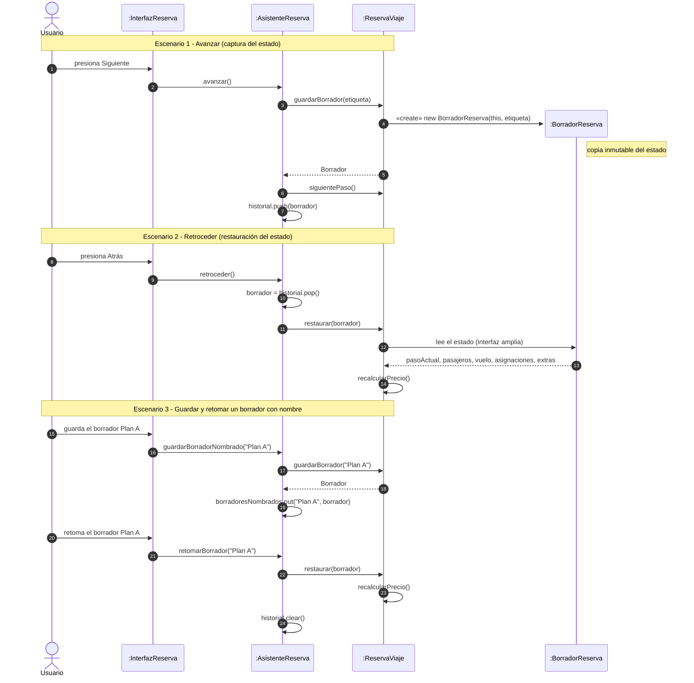
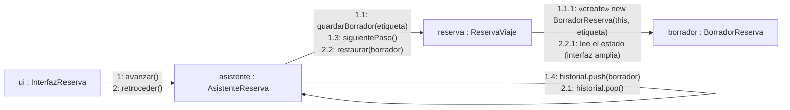
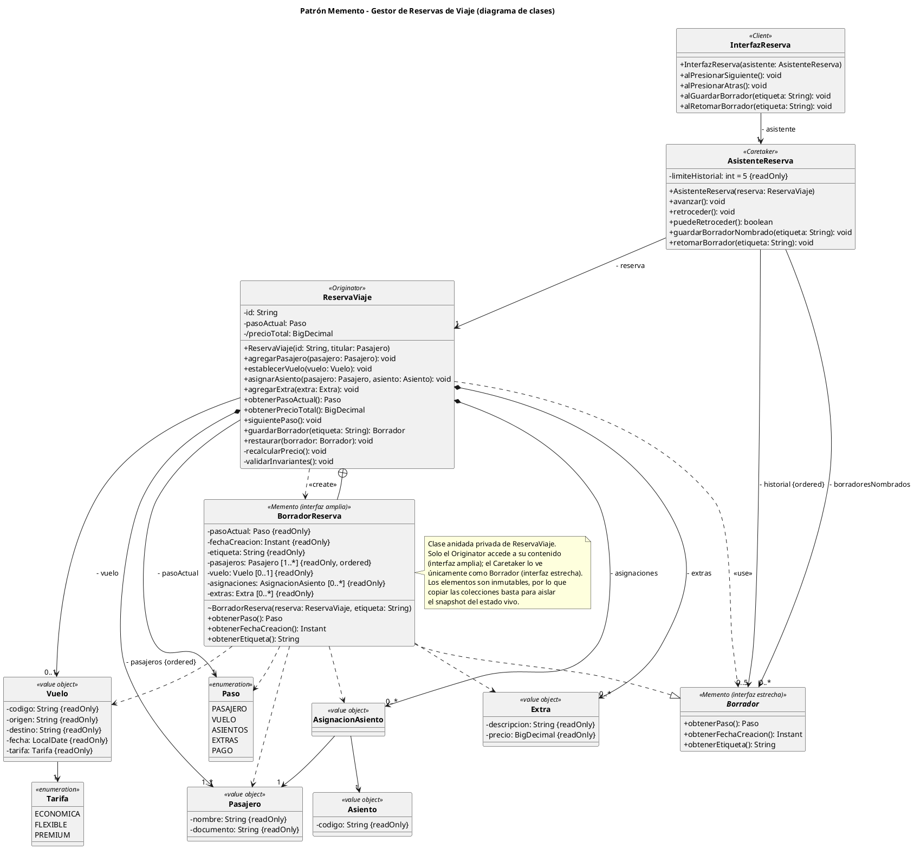

**Maestría en SOFTWARE**

**Asignatura:** Patrones de Diseño de Software
**Actividad #:** 03 — Patrones de comportamiento
**Docente:** Mauricio Ortiz Ochoa

---

# Actividad de aprendizaje #03: Patrones de comportamiento

## Fecha

- Jueves, 29 de octubre de 2026.

## Grupo base

- Grupo 06

## Integrantes

- Cabrera Bonilla Brando Daniel
- Cabrera Carbajal Wilson Alexander
- Espinoza López Cristian Paúl
- Jiménez Quevedo Cristian Geovanny

## Resultado de aprendizaje

- RA3. Implementa soluciones aplicando patrones de comportamiento para organizar responsabilidades e interacciones entre objetos.

## Entregables

- Archivo en PDF con el siguiente nombre: `PDS_Actividad_03_Grupo06.pdf`
- Aplicación de software almacenada en repositorio de código.
- Incluso si la actividad se realiza en grupo, la carga al AVAC debe ser individual.

## Tareas específicas

- Participar en las clases de la Unidad 03, secciones 01 y 02.
- Leer detenidamente el material de apoyo relacionado con los patrones de comportamiento.
- Crear un repositorio de código para almacenar la aplicación solicitada.
- Analizar los escenarios seleccionados e identificar el problema de comportamiento que debe resolverse.
- Seleccionar y justificar los patrones de diseño correspondientes.
- Elaborar los diagramas de clases UML de las soluciones propuestas.
- Implementar las soluciones manteniendo correspondencia entre el modelo UML y el código.
- Utilizar inteligencia artificial como apoyo para revisar, cuestionar y mejorar las decisiones de diseño.
- Documentar al menos una recomendación de la IA que haya sido aceptada, modificada o rechazada, justificando la decisión tomada.
- Seguir las instrucciones específicas de la actividad.

## Instrucciones

### 1. Selección de patrones

Cada grupo deberá seleccionar 2 patrones de comportamiento de entre los siguientes:

- Chain of Responsibility
- Mediator
- Command
- Interpreter
- Iterator
- Memento
- Visitor

Los patrones seleccionados no deben ser los patrones desarrollados directamente en clase.

### 2. Definición del problema

Para cada patrón seleccionado, el grupo deberá:

- plantear un escenario o problema realista;
- describir claramente el contexto;
- identificar las responsabilidades e interacciones que generan el problema de diseño;
- explicar por qué una solución directa o basada únicamente en condicionales, dependencias o llamadas explícitas puede dificultar la evolución del sistema.

### 3. Selección y justificación

Para cada escenario:

- justificar por qué el patrón seleccionado es adecuado;
- identificar los participantes del patrón dentro del dominio;
- explicar qué responsabilidades asume cada participante;
- describir cómo colaboran los objetos para resolver el problema.

### 4. Modelado UML

Elaborar un diagrama de clases UML para cada solución que muestre:

- clases e interfaces;
- atributos y operaciones relevantes;
- relaciones;
- navegabilidad cuando corresponda;
- multiplicidades cuando aporten información;
- participantes del patrón claramente identificados.

### 5. Implementación

Implementar ambas soluciones en un lenguaje de programación orientado a objetos.

La implementación deberá:

- mantener correspondencia con los diagramas UML;
- evidenciar claramente el patrón aplicado;
- evitar dependencias innecesarias;
- mantener responsabilidades coherentes entre las clases.

### 6. Validación de la solución

Para cada patrón, el grupo deberá explicar:

- qué problema resolvió;
- qué mejoró respecto de una solución directa;
- qué costos o complejidad adicional introdujo;
- en qué situación no recomendaría utilizar el patrón.

### 7. Uso crítico de inteligencia artificial

La IA puede utilizarse como apoyo para:

- analizar el escenario;
- cuestionar decisiones de diseño;
- revisar el UML;
- generar o revisar código;
- proponer pruebas o alternativas.

### 8. Documentación del uso de IA

El grupo deberá documentar al menos una recomendación de la IA que haya sido aceptada, modificada o rechazada, explicando la decisión tomada.

---

## Patrón 01: Memento — Gestor de Reservas de Viaje

### Escenario / Motivación

**Escenario.** Una agencia en línea permite reservar un viaje mediante un asistente de cinco pasos:

1. **Pasajero:** datos personales y documento.
2. **Vuelo:** origen, destino, fecha y tarifa.
3. **Asientos:** selección de asiento por pasajero.
4. **Extras:** equipaje, seguro y comidas.
5. **Pago:** confirmación y cobro.

Durante el proceso se pueden presentar tres situaciones:

- El usuario vuelve a un paso anterior para corregir un dato y avanza de nuevo.
- Prueba una configuración, la descarta y regresa a la anterior.
- Abandona el proceso y retoma el borrador más tarde.

**Contexto.** La reserva en construcción (`ReservaViaje`) tiene un estado interno con reglas de negocio:

| Tipo de estado | Ejemplos |
|---|---|
| Datos ingresados | Pasajeros, vuelo, asientos, extras |
| Datos derivados | Precio total, impuestos, descuentos por tarifa o extras |
| Invariantes | Un asiento por pasajero, extras compatibles con la tarifa, fecha futura |
| Estado de flujo | Paso actual, pasos completados |

Los datos derivados dependen de los ingresados. Por ejemplo, cambiar la tarifa recalcula el precio e invalida asientos y extras ya elegidos. Por eso el usuario no puede ni debe manipular estos datos directamente.

**Responsabilidades e interacciones que generan el problema.**

- **La reserva (`ReservaViaje`)** debe mantener su consistencia interna. Es la única que conoce qué campos forman su estado y cómo se relacionan.
- **El asistente (controlador del flujo)** coordina la navegación: avanzar, retroceder, guardar borrador y retomarlo. Necesita poder devolver la reserva a un estado anterior.
- **La interfaz** muestra el paso actual y envía las acciones del usuario.

La tensión está entre dos necesidades: el asistente necesita **capturar y restaurar** el estado de la reserva, y la reserva necesita **protegerlo** para no quedar inconsistente. Quien guarda y restaura debe ser un tercero, pero ese tercero no debería conocer ni modificar la estructura interna.

### Problema de diseño identificado

**Solución directa típica.** El asistente copia campo por campo cuando necesita guardar el estado y los reasigna cuando necesita restaurarlo:

**Dificultades que presenta.**

1. **Rompe el encapsulamiento.** Para que el asistente copie y restaure, la reserva debe exponer getters y setters de todos sus campos, incluidos los derivados como el precio.
2. **Permite estados inconsistentes.** Restaurar `precioTotal` con un setter puede dejarlo inconsistente con los extras. Las invariantes quedan en manos de quien restaura.
3. **Acopla el asistente a la estructura de la reserva.** Si se añade un campo (por ejemplo `programaFidelidad`) o se cambia uno de tipo, hay que modificar el asistente y todo código que guarde o restaure. Es un cambio en cascada, y un campo olvidado produce errores silenciosos.
4. **Comparte referencias mutables.** Si el respaldo guarda la misma lista de pasajeros, las ediciones posteriores contaminan el respaldo. Evitarlo exige copias profundas, y la lógica de copia acaba dispersa por el sistema.
5. **Mezcla responsabilidades.** Si la reserva gestiona su propio historial, además de sus reglas de negocio tiene que manejar pilas, límites y borradores. Eso viola la responsabilidad única y dificulta probarla.
6. **Escala mal con nuevos requisitos.** Guardar borradores con nombre, limitar el número de pasos recordados o persistir el borrador exige tocar tanto la reserva como el asistente. Con condicionales por tipo de paso (`if (paso == ASIENTOS) ...`), cada paso nuevo añade ramas.

**Aspecto que necesita organizarse.** Es necesario capturar y restaurar el estado interno de la reserva sin exponerlo, separando la responsabilidad de *guardar el historial* (asistente) de la de *conocer y proteger el estado* (reserva). Así la estructura interna puede evolucionar sin afectar al resto del sistema.

### Justificación del patrón

**Por qué Memento es adecuado.** Memento resuelve exactamente la tensión descrita: externaliza el estado de un objeto para restaurarlo después, sin violar su encapsulamiento. Cada parte del problema se corresponde con una característica del patrón:

| Necesidad del problema | Cómo la resuelve Memento |
|---|---|
| Capturar el estado sin exponer los campos | Solo la reserva crea el memento y lee su contenido. El resto lo trata como un objeto opaco. |
| Evitar estados inconsistentes al restaurar | La reserva restaura su propio estado, y el memento es inmutable y se copia en profundidad al crearse. |
| Que el asistente no dependa de la estructura de la reserva | El asistente solo guarda y devuelve mementos, sin conocer su contenido. |
| Separar historial y reglas de negocio | El historial vive en el asistente (Caretaker) y las reglas en la reserva (Originator). |
| Añadir campos a la reserva sin romper el resto | Solo cambian `ReservaViaje` y su memento. |

**Alternativas consideradas.**

| Alternativa | Por qué se descartó |
|---|---|
| Getters y setters públicos (solución directa) | Rompe el encapsulamiento y acopla el asistente a la estructura interna (sección anterior). |
| **Command** con operaciones inversas (`deshacer()`) | Obliga a definir la operación inversa de cada acción. Recalcular precios y descuentos hacia atrás es frágil, mientras que restaurar un estado completo es más simple y fiable. Command sería preferible si el estado fuera muy grande y los cambios pequeños. |
| **Prototype** (clonar la reserva completa) | Resuelve la copia, pero el cliente recibiría una reserva completa y manipulable, no un estado opaco. También clonaría comportamiento que no hace falta guardar. |
| Serialización a JSON o a base de datos | Es adecuada para persistir borradores a largo plazo, pero expone el formato interno y añade costo de E/S para una simple navegación hacia atrás. |
| **Event Sourcing** | Es desproporcionado para un flujo de cinco pasos, y exige reconstruir el estado reproduciendo eventos. |

**Conclusión de la justificación.** Memento ofrece la solución más simple que protege las invariantes de la reserva y desacopla el historial de las reglas de negocio. El costo es el consumo de memoria por cada snapshot, que es aceptable porque la reserva es pequeña y el historial se limita a cinco pasos.

### Participantes del patrón

Participantes GoF dentro de la solución propuesta:

- **Originator** → `ReservaViaje`
- **Memento** → `BorradorReserva` (interfaz amplia, solo para el Originator) y `Borrador` (interfaz estrecha, visible para el Caretaker)
- **Caretaker** → `AsistenteReserva`
- **Client** → `InterfazReserva` (opcional; envía las acciones del usuario al asistente)

**Responsabilidades de cada participante.**

| Participante | Clase | Responsabilidades |
|---|---|---|
| Originator | `ReservaViaje` | Mantiene el estado de la reserva y sus invariantes. Crea un memento con una copia de su estado actual (`guardarBorrador()`). Restaura su estado desde un memento (`restaurar(BorradorReserva)`). |
| Memento | `BorradorReserva` | Almacena una copia inmutable del estado de la reserva. Solo `ReservaViaje` puede leer su contenido. Para el resto es opaco y solo expone metadatos inofensivos, como el paso y la fecha del borrador. |
| Caretaker | `AsistenteReserva` | Guarda los mementos en orden (pila de historial) y decide cuándo capturar y cuándo restaurar. Aplica la política del historial: límite de pasos y borradores con nombre. Nunca lee ni modifica el contenido de un memento. |
| Client | `InterfazReserva` | Traduce las acciones del usuario (siguiente, atrás, guardar borrador, retomar) en llamadas al asistente. |

**Aplicación de las dos interfaces del Memento.** El patrón distingue una interfaz *estrecha* (para el Caretaker) y una *amplia* (para el Originator). En la implementación esto se logra con una clase de acceso restringido, por ejemplo una clase anidada o de paquete, de modo que el contenido solo sea accesible desde `ReservaViaje`.

**Colaboración entre los objetos.**

1. **Avanzar:** el asistente pide a la reserva un borrador (`guardarBorrador()`). La reserva crea un `BorradorReserva` con una copia profunda de su estado y lo devuelve. El asistente lo apila sin inspeccionarlo y luego avanza al siguiente paso.
2. **Retroceder:** el asistente retira el último memento de la pila y se lo entrega a la reserva (`restaurar(borrador)`). La reserva sobrescribe su estado desde el memento, manteniendo sus invariantes.
3. **Guardar y retomar un borrador:** el asistente conserva el memento con un nombre. Al retomar, lo entrega de nuevo a la reserva.

**Diagrama de secuencia.** Muestra el orden de los mensajes en los tres escenarios.



**Diagrama de comunicación (colaboración).** Muestra los objetos y los mensajes numerados que intercambian. El número `1.x` corresponde a avanzar y el `2.x` a retroceder.



Los fuentes están en `diagramas/memento-colaboracion-secuencia.mmd` y `diagramas/memento-colaboracion-comunicacion.mmd`. Las imágenes exportadas, para el PDF, están en `diagramas/memento-colaboracion-secuencia.png` y `diagramas/memento-colaboracion-comunicacion.png`.

**Límite del patrón en este dominio.** El memento restaura solo el estado en memoria de la reserva. Los recursos externos, como los asientos bloqueados en un inventario, no se restauran con el patrón. Habrá que liberarlos o reservarlos de nuevo mediante el servicio correspondiente. Este límite se retoma en la sección de validación.

### Diagrama de clases UML

**Fuente del diagrama:** `diagramas/memento-gestor-reservas.puml` (PlantUML).



**Elementos de notación utilizados.**

| Elemento UML | Uso en el diagrama |
|---|---|
| Estereotipos `«Originator»`, `«Caretaker»`, `«Client»`, `«Memento»` | Identifican los participantes del patrón. |
| Realización (línea discontinua, triángulo hueco) | `BorradorReserva` realiza `Borrador`. |
| Clase anidada (círculo con cruz, `⊕`) | `BorradorReserva` está anidada en `ReservaViaje`, de modo que solo el Originator accede a su contenido. |
| Dependencia (línea discontinua, flecha abierta) con `«create»` y `«use»` | `ReservaViaje` crea `BorradorReserva` y recibe un `Borrador` al restaurar. |
| Asociación dirigida con multiplicidad y rol | `AsistenteReserva` conoce a `ReservaViaje` y a los `Borrador`, pero no al revés. |
| Composición (rombo relleno) | `ReservaViaje` es dueña de sus pasajeros, asignaciones y extras. |
| Atributo derivado `/precioTotal` | Se calcula a partir de vuelo, tarifa y extras, por eso no se restaura directamente. |
| Restricciones `{readOnly}`, `{ordered}` | Inmutabilidad del memento y orden del historial. |

```plantuml
@startuml memento-gestor-reservas
skinparam classAttributeIconSize 0
hide circle

class InterfazReserva <<Client>> {
  + InterfazReserva(asistente: AsistenteReserva)
  + alPresionarSiguiente(): void
  + alPresionarAtras(): void
  + alGuardarBorrador(etiqueta: String): void
  + alRetomarBorrador(etiqueta: String): void
}
class AsistenteReserva <<Caretaker>> {
  - limiteHistorial: int = 5 {readOnly}
  + AsistenteReserva(reserva: ReservaViaje)
  + avanzar(): void
  + retroceder(): void
  + puedeRetroceder(): boolean
  + guardarBorradorNombrado(etiqueta: String): void
  + retomarBorrador(etiqueta: String): void
}
class ReservaViaje <<Originator>> {
  - id: String
  - pasoActual: Paso
  - /precioTotal: BigDecimal
  + ReservaViaje(id: String, titular: Pasajero)
  + agregarPasajero(pasajero: Pasajero): void
  + establecerVuelo(vuelo: Vuelo): void
  + asignarAsiento(pasajero: Pasajero, asiento: Asiento): void
  + agregarExtra(extra: Extra): void
  + obtenerPasoActual(): Paso
  + obtenerPrecioTotal(): BigDecimal
  + siguientePaso(): void
  + guardarBorrador(etiqueta: String): Borrador
  + restaurar(borrador: Borrador): void
  - recalcularPrecio(): void
  - validarInvariantes(): void
}
interface Borrador <<Memento (interfaz estrecha)>> {
  + obtenerPaso(): Paso
  + obtenerFechaCreacion(): Instant
  + obtenerEtiqueta(): String
}
class BorradorReserva <<Memento (interfaz amplia)>> {
  - pasoActual: Paso {readOnly}
  - fechaCreacion: Instant {readOnly}
  - etiqueta: String {readOnly}
  - pasajeros: Pasajero [1..*] {readOnly, ordered}
  - vuelo: Vuelo [0..1] {readOnly}
  - asignaciones: AsignacionAsiento [0..*] {readOnly}
  - extras: Extra [0..*] {readOnly}
  ~ BorradorReserva(reserva: ReservaViaje, etiqueta: String)
  + obtenerPaso(): Paso
  + obtenerFechaCreacion(): Instant
  + obtenerEtiqueta(): String
}
enum Paso <<enumeration>> { PASAJERO VUELO ASIENTOS EXTRAS PAGO }
enum Tarifa <<enumeration>> { ECONOMICA FLEXIBLE PREMIUM }
class Pasajero <<value object>> {
  - nombre: String {readOnly}
  - documento: String {readOnly}
}
class Vuelo <<value object>> {
  - codigo: String {readOnly}
  - origen: String {readOnly}
  - destino: String {readOnly}
  - fecha: LocalDate {readOnly}
  - tarifa: Tarifa {readOnly}
}
class Asiento <<value object>> { - codigo: String {readOnly} }
class Extra <<value object>> {
  - descripcion: String {readOnly}
  - precio: BigDecimal {readOnly}
}
class AsignacionAsiento <<value object>>

InterfazReserva --> "1" AsistenteReserva : - asistente
AsistenteReserva --> "1" ReservaViaje : - reserva
AsistenteReserva --> "0..5" Borrador : - historial {ordered}
AsistenteReserva --> "0..*" Borrador : - borradoresNombrados
BorradorReserva ..|> Borrador
ReservaViaje +-- BorradorReserva
ReservaViaje ..> BorradorReserva : <<create>>
ReservaViaje ..> Borrador : <<use>>
ReservaViaje *--> "1..*" Pasajero : - pasajeros {ordered}
ReservaViaje *--> "0..*" AsignacionAsiento : - asignaciones
ReservaViaje *--> "0..*" Extra : - extras
ReservaViaje --> "0..1" Vuelo : - vuelo
ReservaViaje --> "1" Paso : - pasoActual
AsignacionAsiento --> "1" Pasajero
AsignacionAsiento --> "1" Asiento
Vuelo --> "1" Tarifa
@enduml
```

### Código fuente

**Repositorio / enlace:** https://github.com/cristian-espinoza-developer/patrones-comportamiento/memento-gestor-reservas (proyecto Maven, Java 17).

**Correspondencia UML–código.**

| Participante / elemento UML | Clase Java |
|---|---|
| Originator | `dominio.ReservaViaje` |
| Memento (interfaz amplia) | `ReservaViaje.BorradorReserva` (clase anidada privada) |
| Memento (interfaz estrecha) | `dominio.Borrador` |
| Caretaker | `asistente.AsistenteReserva` |
| Client | `cliente.InterfazReserva` |
| Objetos de valor del dominio | `Pasajero`, `Vuelo`, `Asiento`, `Extra`, `AsignacionAsiento` (`record`) y enumeraciones `Paso`, `Tarifa` |

**Ejecución de la demostración** (requiere JDK 17 o superior):

```bash
cd memento-gestor-reservas
mvn compile exec:java
```

La clase `App` recorre el flujo: avanza pasos, retrocede, guarda un borrador con nombre, prueba otra configuración y lo retoma. Muestra cómo se restauran los asientos y el precio.

### Validación de la solución

**Qué problema resolvió.** Permite capturar y restaurar el estado de `ReservaViaje` (navegación hacia atrás, prueba de configuraciones alternativas y borradores con nombre) sin exponer sus campos ni sus datos derivados. `AsistenteReserva` guarda y devuelve borradores sin conocer su contenido, y `ReservaViaje` conserva el control de sus invariantes.

**Qué mejoró respecto de una solución directa.**

| Aspecto | Solución directa (getters/setters) | Con Memento |
|---|---|---|
| Encapsulamiento | La reserva expone todos sus campos, incluido el precio. | Solo `ReservaViaje` accede al contenido del memento (`BorradorReserva` es privado). |
| Consistencia | Restaurar `precioTotal` con un setter puede contradecir los extras. | `restaurar()` recalcula el precio desde los datos restaurados. |
| Evolución | Un campo nuevo obliga a modificar el asistente y todo código que guarde o restaure. | Solo cambian `ReservaViaje` y `BorradorReserva`; `AsistenteReserva` no se toca. |
| Aislamiento del respaldo | Las referencias mutables compartidas contaminan el respaldo. | El memento copia las colecciones y los elementos son `record` inmutables. |
| Responsabilidades | La reserva mezclaría reglas de negocio con gestión del historial. | El historial y su política (límite de 5 pasos, borradores con nombre) viven en el Caretaker. |

**Qué costos o complejidad adicional introdujo.**

- **Más clases.** Se añaden `Borrador` y `BorradorReserva`, y la clase anidada debe mantenerse sincronizada con los campos de `ReservaViaje`. Si se añade un atributo y se olvida copiarlo en el memento, el error es silencioso.
- **Memoria.** Cada snapshot copia las colecciones. Aquí es aceptable porque el estado es pequeño y el historial está limitado a 5 pasos.
- **Conversión de tipo.** `restaurar(Borrador)` recibe la interfaz estrecha y debe convertirla a `BorradorReserva`. Es el compromiso habitual de Memento en Java.
- **Inmutabilidad como requisito.** Copiar solo las colecciones funciona porque `Pasajero`, `Vuelo`, `Extra`, etc. son inmutables. Si dejaran de serlo, habría que hacer copias profundas.
- **Semántica del retroceso.** `retroceder()` descarta los cambios hechos en el paso actual, porque restaura el estado previo al último avance. Es una decisión de diseño que hay que comunicar al usuario.
- **Límite del patrón.** Restaura solo el estado en memoria. Los recursos externos, como los asientos bloqueados en un inventario, no se restauran y habría que liberarlos o reservarlos de nuevo mediante el servicio correspondiente. Esta demostración no simula ese inventario.
- **Sin persistencia.** Los borradores viven en memoria y se pierden al cerrar la aplicación.

**En qué situación no se recomendaría usarlo.**

- Cuando el estado es muy grande y los cambios son pequeños. Conviene **Command** con operaciones inversas, o almacenar solo las diferencias.
- Cuando el estado relevante vive en sistemas externos, como una base de datos o un inventario. El memento daría una falsa sensación de restauración.
- Cuando los borradores deben persistir a largo plazo o sobrevivir a nuevas versiones del software. Ahí hace falta serialización versionada.
- Cuando el objeto es pequeño e inmutable, o hay que capturar el estado con una frecuencia tan alta que el costo de memoria sea inaceptable.

### Uso crítico de inteligencia artificial

**Usos de la IA como apoyo en este patrón.**

- Analizar el contexto y proponer tres escenarios candidatos para Memento.
- Redactar el análisis del problema, la justificación y la comparación con alternativas.
- Generar el diagrama UML en PlantUML con notación estricta.
- Generar el código Java y revisarlo ejecutándolo.

- **Prompt principal:** "Debes actuar como un experto en desarrollo de software y patrones de arquitectura de software y trabajar exclusivamente en el patrón MEMENTO para proponer 3 posibles escenarios o problemas realistas que permitan desarrollar este patrón".
- **Recomendación aceptada y justificación:** la IA propuso tres escenarios (editor de documentos, wizard de reservas y juego con checkpoints) y recomendó el wizard de reservas. El grupo lo aceptó y lo renombró "Gestor de Reservas de Viaje". Se aceptó porque el estado tiene datos derivados e invariantes, que justifican proteger el encapsulamiento, y porque tiene un límite natural (los recursos externos no se restauran) que enriquece la sección de validación. El editor de documentos se consideró demasiado típico, y el juego implicaba mayor esfuerzo de copia profunda.
- **Recomendación modificada o rechazada y justificación:**
  - *Modificada.* En el primer diagrama UML propuesto por la IA, `ReservaViaje` y el memento tenían la multiplicidad de pasajeros `1..*`, pero una reserva recién creada no tiene pasajeros, por lo que el primer borrador habría violado el modelo. Al implementar, se modificó el diseño: el constructor recibe un titular (`ReservaViaje(id, titular)`) y el UML se actualizó para mantener la correspondencia con el código.
  - *No adoptada por ahora.* La IA señaló que `restaurar()` acepta un memento de cualquier reserva y que podría comprobarse que pertenece a la misma (añadiendo el `id` al memento). No se incorporó para mantener el modelo simple y alineado con el UML. Se deja como mejora posible.
  - *Decisión propia sobre la validación al restaurar.* El código no vuelve a validar invariantes tras `restaurar()`, porque los mementos provienen de estados ya válidos y una validación, por ejemplo de fecha futura, podría fallar a mitad de la restauración y dejar la reserva a medias.

---

## Patrón 02:

### Escenario / Motivación

Describa el problema seleccionado, el contexto en el que ocurre y las responsabilidades o interacciones entre objetos que generan la necesidad de aplicar el patrón.

### Problema de diseño identificado

Explique qué dificultad presenta una solución directa y qué aspecto del comportamiento o de la interacción entre objetos necesita organizarse.

### Justificación del patrón

Explique por qué el patrón seleccionado es adecuado para resolver el problema y qué alternativas fueron consideradas.

### Participantes del patrón

Identifique los participantes GoF dentro de la solución propuesta:

- Participante 1 → ______________________________
- Participante 2 → ______________________________
- Participante 3 → ______________________________
- Participante N → ______________________________

### Diagrama de clases UML

*Insertar aquí el diagrama UML de la solución.*

El diagrama debe mostrar:

- clases e interfaces;
- atributos y operaciones relevantes;
- relaciones y navegabilidad cuando corresponda;
- multiplicidades cuando aporten información;
- correspondencia clara con los participantes del patrón.

### Código fuente

**Repositorio / enlace:**

### Uso crítico de inteligencia artificial

- **Prompt principal:**
- **Recomendación aceptada y justificación:**
- **Recomendación modificada o rechazada y justificación:**

---

## Conclusiones (200 palabras)

### Patrón Memento (89 palabras)

El patrón Memento permitió separar la captura y restauración del estado de la reserva de las reglas que lo protegen. El Caretaker gestiona el historial sin conocer el contenido de los borradores, y el Originator recalcula los datos derivados al restaurar, evitando estados inconsistentes. Añadir atributos a la reserva solo afecta a la reserva y a su memento. A cambio, introduce más clases y consumo de memoria, y no restaura recursos externos como el inventario de asientos. Es adecuado con estados pequeños y encapsulados; con estados grandes conviene Command.

---

## Rúbrica de evaluación

| Criterios | No presenta | Nivel Bajo | Nivel Medio | Nivel Alto |
|---|:---:|:---:|:---:|:---:|
| Selección, justificación y diagrama UML del Patrón 01 | 0 | 2 | 4 | 6 |
| Implementación funcional y correspondencia UML–código del Patrón 01 | 0 | 2 | 4 | 6 |
| Selección, justificación y diagrama UML del Patrón 02 | 0 | 2 | 4 | 6 |
| Implementación funcional y correspondencia UML–código del Patrón 02 | 0 | 2 | 4 | 6 |
| Uso crítico de IA, síntesis comparativa, justificación y conclusiones | 0 | 2 | 4 | 6 |

## Documentos

- Unidad_03_01_PDS.pdf
- Unidad_03_02_PDS.pdf
