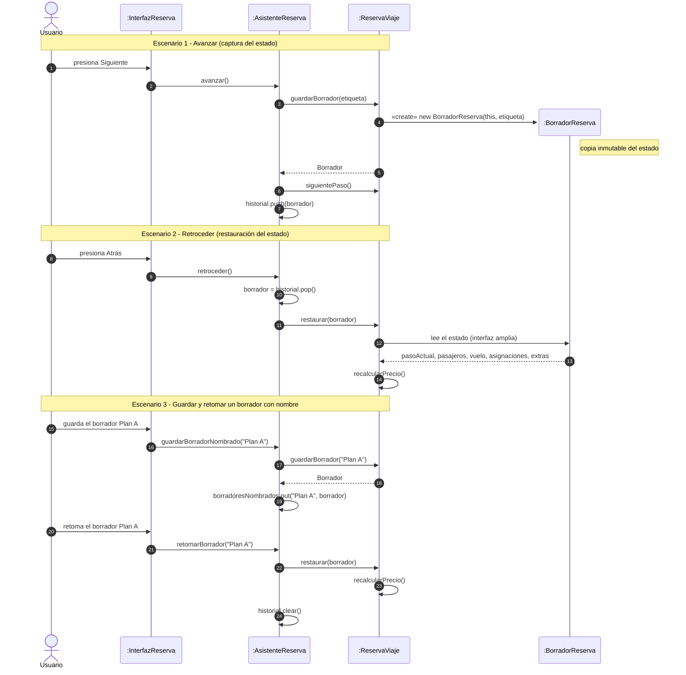
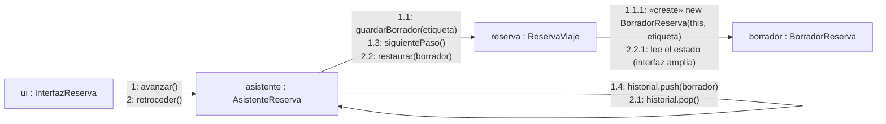
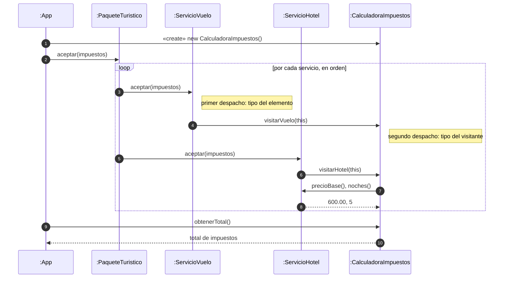
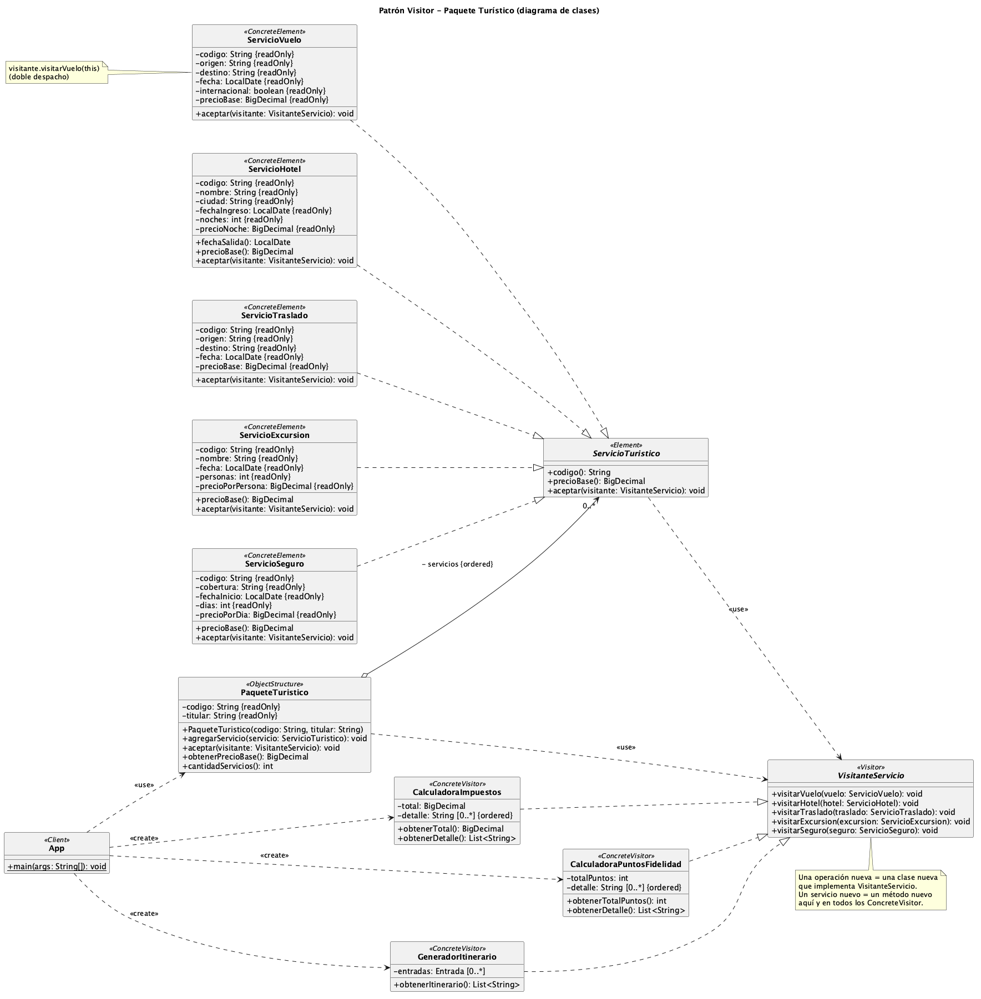

**Maestría en SOFTWARE**

**Asignatura:** Patrones de Diseño de Software
**Actividad #:** 03 — Patrones de comportamiento
**Docente:** Mauricio Ortiz Ochoa

---

# Actividad de aprendizaje #03: Patrones de comportamiento

## Fecha

- Jueves, 29 de octubre de 2026.

## Grupo base

- Grupo 06

## Integrantes

- Cabrera Bonilla Brando Daniel
- Cabrera Carbajal Wilson Alexander
- Espinoza López Cristian Paúl
- Jiménez Quevedo Cristian Geovanny

## Resultado de aprendizaje

- RA3. Implementa soluciones aplicando patrones de comportamiento para organizar responsabilidades e interacciones entre objetos.

## Entregables

- Archivo en PDF con el siguiente nombre: `PDS_Actividad_03_Grupo06.pdf`
- Aplicación de software almacenada en repositorio de código.
- Incluso si la actividad se realiza en grupo, la carga al AVAC debe ser individual.

## Tareas específicas

- Participar en las clases de la Unidad 03, secciones 01 y 02.
- Leer detenidamente el material de apoyo relacionado con los patrones de comportamiento.
- Crear un repositorio de código para almacenar la aplicación solicitada.
- Analizar los escenarios seleccionados e identificar el problema de comportamiento que debe resolverse.
- Seleccionar y justificar los patrones de diseño correspondientes.
- Elaborar los diagramas de clases UML de las soluciones propuestas.
- Implementar las soluciones manteniendo correspondencia entre el modelo UML y el código.
- Utilizar inteligencia artificial como apoyo para revisar, cuestionar y mejorar las decisiones de diseño.
- Documentar al menos una recomendación de la IA que haya sido aceptada, modificada o rechazada, justificando la decisión tomada.
- Seguir las instrucciones específicas de la actividad.

## Instrucciones

### 1. Selección de patrones

Cada grupo deberá seleccionar 2 patrones de comportamiento de entre los siguientes:

- Chain of Responsibility
- Mediator
- Command
- Interpreter
- Iterator
- Memento
- Visitor

Los patrones seleccionados no deben ser los patrones desarrollados directamente en clase.

### 2. Definición del problema

Para cada patrón seleccionado, el grupo deberá:

- plantear un escenario o problema realista;
- describir claramente el contexto;
- identificar las responsabilidades e interacciones que generan el problema de diseño;
- explicar por qué una solución directa o basada únicamente en condicionales, dependencias o llamadas explícitas puede dificultar la evolución del sistema.

### 3. Selección y justificación

Para cada escenario:

- justificar por qué el patrón seleccionado es adecuado;
- identificar los participantes del patrón dentro del dominio;
- explicar qué responsabilidades asume cada participante;
- describir cómo colaboran los objetos para resolver el problema.

### 4. Modelado UML

Elaborar un diagrama de clases UML para cada solución que muestre:

- clases e interfaces;
- atributos y operaciones relevantes;
- relaciones;
- navegabilidad cuando corresponda;
- multiplicidades cuando aporten información;
- participantes del patrón claramente identificados.

### 5. Implementación

Implementar ambas soluciones en un lenguaje de programación orientado a objetos.

La implementación deberá:

- mantener correspondencia con los diagramas UML;
- evidenciar claramente el patrón aplicado;
- evitar dependencias innecesarias;
- mantener responsabilidades coherentes entre las clases.

### 6. Validación de la solución

Para cada patrón, el grupo deberá explicar:

- qué problema resolvió;
- qué mejoró respecto de una solución directa;
- qué costos o complejidad adicional introdujo;
- en qué situación no recomendaría utilizar el patrón.

### 7. Uso crítico de inteligencia artificial

La IA puede utilizarse como apoyo para:

- analizar el escenario;
- cuestionar decisiones de diseño;
- revisar el UML;
- generar o revisar código;
- proponer pruebas o alternativas.

### 8. Documentación del uso de IA

El grupo deberá documentar al menos una recomendación de la IA que haya sido aceptada, modificada o rechazada, explicando la decisión tomada.

---

## Patrón 01: Memento — Gestor de Reservas de Viaje

### Escenario / Motivación

**Escenario.** Una agencia en línea permite reservar un viaje mediante un asistente de cinco pasos:

1. **Pasajero:** datos personales y documento.
2. **Vuelo:** origen, destino, fecha y tarifa.
3. **Asientos:** selección de asiento por pasajero.
4. **Extras:** equipaje, seguro y comidas.
5. **Pago:** confirmación y cobro.

Durante el proceso se pueden presentar tres situaciones:

- El usuario vuelve a un paso anterior para corregir un dato y avanza de nuevo.
- Prueba una configuración, la descarta y regresa a la anterior.
- Abandona el proceso y retoma el borrador más tarde.

**Contexto.** La reserva en construcción (`ReservaViaje`) tiene un estado interno con reglas de negocio:

| Tipo de estado | Ejemplos |
|---|---|
| Datos ingresados | Pasajeros, vuelo, asientos, extras |
| Datos derivados | Precio total, impuestos, descuentos por tarifa o extras |
| Invariantes | Un asiento por pasajero, extras compatibles con la tarifa, fecha futura |
| Estado de flujo | Paso actual, pasos completados |

Los datos derivados dependen de los ingresados. Por ejemplo, cambiar la tarifa recalcula el precio e invalida asientos y extras ya elegidos. Por eso el usuario no puede ni debe manipular estos datos directamente.

**Responsabilidades e interacciones que generan el problema.**

- **La reserva (`ReservaViaje`)** debe mantener su consistencia interna. Es la única que conoce qué campos forman su estado y cómo se relacionan.
- **El asistente (controlador del flujo)** coordina la navegación: avanzar, retroceder, guardar borrador y retomarlo. Necesita poder devolver la reserva a un estado anterior.
- **La interfaz** muestra el paso actual y envía las acciones del usuario.

La tensión está entre dos necesidades: el asistente necesita **capturar y restaurar** el estado de la reserva, y la reserva necesita **protegerlo** para no quedar inconsistente. Quien guarda y restaura debe ser un tercero, pero ese tercero no debería conocer ni modificar la estructura interna.

### Problema de diseño identificado

**Solución directa típica.** El asistente copia campo por campo cuando necesita guardar el estado y los reasigna cuando necesita restaurarlo:

**Dificultades que presenta.**

1. **Rompe el encapsulamiento.** Para que el asistente copie y restaure, la reserva debe exponer getters y setters de todos sus campos, incluidos los derivados como el precio.
2. **Permite estados inconsistentes.** Restaurar `precioTotal` con un setter puede dejarlo inconsistente con los extras. Las invariantes quedan en manos de quien restaura.
3. **Acopla el asistente a la estructura de la reserva.** Si se añade un campo (por ejemplo `programaFidelidad`) o se cambia uno de tipo, hay que modificar el asistente y todo código que guarde o restaure. Es un cambio en cascada, y un campo olvidado produce errores silenciosos.
4. **Comparte referencias mutables.** Si el respaldo guarda la misma lista de pasajeros, las ediciones posteriores contaminan el respaldo. Evitarlo exige copias profundas, y la lógica de copia acaba dispersa por el sistema.
5. **Mezcla responsabilidades.** Si la reserva gestiona su propio historial, además de sus reglas de negocio tiene que manejar pilas, límites y borradores. Eso viola la responsabilidad única y dificulta probarla.
6. **Escala mal con nuevos requisitos.** Guardar borradores con nombre, limitar el número de pasos recordados o persistir el borrador exige tocar tanto la reserva como el asistente. Con condicionales por tipo de paso (`if (paso == ASIENTOS) ...`), cada paso nuevo añade ramas.

**Aspecto que necesita organizarse.** Es necesario capturar y restaurar el estado interno de la reserva sin exponerlo, separando la responsabilidad de *guardar el historial* (asistente) de la de *conocer y proteger el estado* (reserva). Así la estructura interna puede evolucionar sin afectar al resto del sistema.

### Justificación del patrón

**Por qué Memento es adecuado.** Memento resuelve exactamente la tensión descrita: externaliza el estado de un objeto para restaurarlo después, sin violar su encapsulamiento. Cada parte del problema se corresponde con una característica del patrón:

| Necesidad del problema | Cómo la resuelve Memento |
|---|---|
| Capturar el estado sin exponer los campos | Solo la reserva crea el memento y lee su contenido. El resto lo trata como un objeto opaco. |
| Evitar estados inconsistentes al restaurar | La reserva restaura su propio estado, y el memento es inmutable y se copia en profundidad al crearse. |
| Que el asistente no dependa de la estructura de la reserva | El asistente solo guarda y devuelve mementos, sin conocer su contenido. |
| Separar historial y reglas de negocio | El historial vive en el asistente (Caretaker) y las reglas en la reserva (Originator). |
| Añadir campos a la reserva sin romper el resto | Solo cambian `ReservaViaje` y su memento. |

**Alternativas consideradas.**

| Alternativa | Por qué se descartó |
|---|---|
| Getters y setters públicos (solución directa) | Rompe el encapsulamiento y acopla el asistente a la estructura interna (sección anterior). |
| **Command** con operaciones inversas (`deshacer()`) | Obliga a definir la operación inversa de cada acción. Recalcular precios y descuentos hacia atrás es frágil, mientras que restaurar un estado completo es más simple y fiable. Command sería preferible si el estado fuera muy grande y los cambios pequeños. |
| **Prototype** (clonar la reserva completa) | Resuelve la copia, pero el cliente recibiría una reserva completa y manipulable, no un estado opaco. También clonaría comportamiento que no hace falta guardar. |
| Serialización a JSON o a base de datos | Es adecuada para persistir borradores a largo plazo, pero expone el formato interno y añade costo de E/S para una simple navegación hacia atrás. |
| **Event Sourcing** | Es desproporcionado para un flujo de cinco pasos, y exige reconstruir el estado reproduciendo eventos. |

**Conclusión de la justificación.** Memento ofrece la solución más simple que protege las invariantes de la reserva y desacopla el historial de las reglas de negocio. El costo es el consumo de memoria por cada snapshot, que es aceptable porque la reserva es pequeña y el historial se limita a cinco pasos.

### Participantes del patrón

Participantes GoF dentro de la solución propuesta:

- **Originator** → `ReservaViaje`
- **Memento** → `BorradorReserva` (interfaz amplia, solo para el Originator) y `Borrador` (interfaz estrecha, visible para el Caretaker)
- **Caretaker** → `AsistenteReserva`
- **Client** → `InterfazReserva` (opcional; envía las acciones del usuario al asistente)

**Responsabilidades de cada participante.**

| Participante | Clase | Responsabilidades |
|---|---|---|
| Originator | `ReservaViaje` | Mantiene el estado de la reserva y sus invariantes. Crea un memento con una copia de su estado actual (`guardarBorrador()`). Restaura su estado desde un memento (`restaurar(BorradorReserva)`). |
| Memento | `BorradorReserva` | Almacena una copia inmutable del estado de la reserva. Solo `ReservaViaje` puede leer su contenido. Para el resto es opaco y solo expone metadatos inofensivos, como el paso y la fecha del borrador. |
| Caretaker | `AsistenteReserva` | Guarda los mementos en orden (pila de historial) y decide cuándo capturar y cuándo restaurar. Aplica la política del historial: límite de pasos y borradores con nombre. Nunca lee ni modifica el contenido de un memento. |
| Client | `InterfazReserva` | Traduce las acciones del usuario (siguiente, atrás, guardar borrador, retomar) en llamadas al asistente. |

**Aplicación de las dos interfaces del Memento.** El patrón distingue una interfaz *estrecha* (para el Caretaker) y una *amplia* (para el Originator). En la implementación esto se logra con una clase de acceso restringido, por ejemplo una clase anidada o de paquete, de modo que el contenido solo sea accesible desde `ReservaViaje`.

**Colaboración entre los objetos.**

1. **Avanzar:** el asistente pide a la reserva un borrador (`guardarBorrador()`). La reserva crea un `BorradorReserva` con una copia profunda de su estado y lo devuelve. El asistente lo apila sin inspeccionarlo y luego avanza al siguiente paso.
2. **Retroceder:** el asistente retira el último memento de la pila y se lo entrega a la reserva (`restaurar(borrador)`). La reserva sobrescribe su estado desde el memento, manteniendo sus invariantes.
3. **Guardar y retomar un borrador:** el asistente conserva el memento con un nombre. Al retomar, lo entrega de nuevo a la reserva.

**Diagrama de secuencia.** Muestra el orden de los mensajes en los tres escenarios.



**Diagrama de comunicación (colaboración).** Muestra los objetos y los mensajes numerados que intercambian. El número `1.x` corresponde a avanzar y el `2.x` a retroceder.



Los fuentes están en `diagramas/memento-colaboracion-secuencia.mmd` y `diagramas/memento-colaboracion-comunicacion.mmd`. Las imágenes exportadas, para el PDF, están en `diagramas/memento-colaboracion-secuencia.png` y `diagramas/memento-colaboracion-comunicacion.png`.

**Límite del patrón en este dominio.** El memento restaura solo el estado en memoria de la reserva. Los recursos externos, como los asientos bloqueados en un inventario, no se restauran con el patrón. Habrá que liberarlos o reservarlos de nuevo mediante el servicio correspondiente. Este límite se retoma en la sección de validación.

### Diagrama de clases UML

**Fuente del diagrama:** `diagramas/memento-gestor-reservas.puml` (PlantUML).


**Elementos de notación utilizados.**

| Elemento UML | Uso en el diagrama |
|---|---|
| Estereotipos `«Originator»`, `«Caretaker»`, `«Client»`, `«Memento»` | Identifican los participantes del patrón. |
| Realización (línea discontinua, triángulo hueco) | `BorradorReserva` realiza `Borrador`. |
| Clase anidada (círculo con cruz, `⊕`) | `BorradorReserva` está anidada en `ReservaViaje`, de modo que solo el Originator accede a su contenido. |
| Dependencia (línea discontinua, flecha abierta) con `«create»` y `«use»` | `ReservaViaje` crea `BorradorReserva` y recibe un `Borrador` al restaurar. |
| Asociación dirigida con multiplicidad y rol | `AsistenteReserva` conoce a `ReservaViaje` y a los `Borrador`, pero no al revés. |
| Composición (rombo relleno) | `ReservaViaje` es dueña de sus pasajeros, asignaciones y extras. |
| Atributo derivado `/precioTotal` | Se calcula a partir de vuelo, tarifa y extras, por eso no se restaura directamente. |
| Restricciones `{readOnly}`, `{ordered}` | Inmutabilidad del memento y orden del historial. |

```plantuml
@startuml memento-gestor-reservas
skinparam classAttributeIconSize 0
hide circle

class InterfazReserva <<Client>> {
  + InterfazReserva(asistente: AsistenteReserva)
  + alPresionarSiguiente(): void
  + alPresionarAtras(): void
  + alGuardarBorrador(etiqueta: String): void
  + alRetomarBorrador(etiqueta: String): void
}
class AsistenteReserva <<Caretaker>> {
  - limiteHistorial: int = 5 {readOnly}
  + AsistenteReserva(reserva: ReservaViaje)
  + avanzar(): void
  + retroceder(): void
  + puedeRetroceder(): boolean
  + guardarBorradorNombrado(etiqueta: String): void
  + retomarBorrador(etiqueta: String): void
}
class ReservaViaje <<Originator>> {
  - id: String
  - pasoActual: Paso
  - /precioTotal: BigDecimal
  + ReservaViaje(id: String, titular: Pasajero)
  + agregarPasajero(pasajero: Pasajero): void
  + establecerVuelo(vuelo: Vuelo): void
  + asignarAsiento(pasajero: Pasajero, asiento: Asiento): void
  + agregarExtra(extra: Extra): void
  + obtenerPasoActual(): Paso
  + obtenerPrecioTotal(): BigDecimal
  + siguientePaso(): void
  + guardarBorrador(etiqueta: String): Borrador
  + restaurar(borrador: Borrador): void
  - recalcularPrecio(): void
  - validarInvariantes(): void
}
interface Borrador <<Memento (interfaz estrecha)>> {
  + obtenerPaso(): Paso
  + obtenerFechaCreacion(): Instant
  + obtenerEtiqueta(): String
}
class BorradorReserva <<Memento (interfaz amplia)>> {
  - pasoActual: Paso {readOnly}
  - fechaCreacion: Instant {readOnly}
  - etiqueta: String {readOnly}
  - pasajeros: Pasajero [1..*] {readOnly, ordered}
  - vuelo: Vuelo [0..1] {readOnly}
  - asignaciones: AsignacionAsiento [0..*] {readOnly}
  - extras: Extra [0..*] {readOnly}
  ~ BorradorReserva(reserva: ReservaViaje, etiqueta: String)
  + obtenerPaso(): Paso
  + obtenerFechaCreacion(): Instant
  + obtenerEtiqueta(): String
}
enum Paso <<enumeration>> { PASAJERO VUELO ASIENTOS EXTRAS PAGO }
enum Tarifa <<enumeration>> { ECONOMICA FLEXIBLE PREMIUM }
class Pasajero <<value object>> {
  - nombre: String {readOnly}
  - documento: String {readOnly}
}
class Vuelo <<value object>> {
  - codigo: String {readOnly}
  - origen: String {readOnly}
  - destino: String {readOnly}
  - fecha: LocalDate {readOnly}
  - tarifa: Tarifa {readOnly}
}
class Asiento <<value object>> { - codigo: String {readOnly} }
class Extra <<value object>> {
  - descripcion: String {readOnly}
  - precio: BigDecimal {readOnly}
}
class AsignacionAsiento <<value object>>

InterfazReserva --> "1" AsistenteReserva : - asistente
AsistenteReserva --> "1" ReservaViaje : - reserva
AsistenteReserva --> "0..5" Borrador : - historial {ordered}
AsistenteReserva --> "0..*" Borrador : - borradoresNombrados
BorradorReserva ..|> Borrador
ReservaViaje +-- BorradorReserva
ReservaViaje ..> BorradorReserva : <<create>>
ReservaViaje ..> Borrador : <<use>>
ReservaViaje *--> "1..*" Pasajero : - pasajeros {ordered}
ReservaViaje *--> "0..*" AsignacionAsiento : - asignaciones
ReservaViaje *--> "0..*" Extra : - extras
ReservaViaje --> "0..1" Vuelo : - vuelo
ReservaViaje --> "1" Paso : - pasoActual
AsignacionAsiento --> "1" Pasajero
AsignacionAsiento --> "1" Asiento
Vuelo --> "1" Tarifa
@enduml
```

### Código fuente

**Repositorio / enlace:** https://github.com/cristian-espinoza-developer/patrones-comportamiento/memento-gestor-reservas (proyecto Maven, Java 17).

**Correspondencia UML–código.**

| Participante / elemento UML | Clase Java |
|---|---|
| Originator | `dominio.ReservaViaje` |
| Memento (interfaz amplia) | `ReservaViaje.BorradorReserva` (clase anidada privada) |
| Memento (interfaz estrecha) | `dominio.Borrador` |
| Caretaker | `asistente.AsistenteReserva` |
| Client | `cliente.InterfazReserva` |
| Objetos de valor del dominio | `Pasajero`, `Vuelo`, `Asiento`, `Extra`, `AsignacionAsiento` (`record`) y enumeraciones `Paso`, `Tarifa` |

**Ejecución de la demostración** (requiere JDK 17 o superior):

```bash
cd memento-gestor-reservas
mvn compile exec:java
```

La clase `App` recorre el flujo: avanza pasos, retrocede, guarda un borrador con nombre, prueba otra configuración y lo retoma. Muestra cómo se restauran los asientos y el precio.

### Validación de la solución

**Qué problema resolvió.** Permite capturar y restaurar el estado de `ReservaViaje` (navegación hacia atrás, prueba de configuraciones alternativas y borradores con nombre) sin exponer sus campos ni sus datos derivados. `AsistenteReserva` guarda y devuelve borradores sin conocer su contenido, y `ReservaViaje` conserva el control de sus invariantes.

**Qué mejoró respecto de una solución directa.**

| Aspecto | Solución directa (getters/setters) | Con Memento |
|---|---|---|
| Encapsulamiento | La reserva expone todos sus campos, incluido el precio. | Solo `ReservaViaje` accede al contenido del memento (`BorradorReserva` es privado). |
| Consistencia | Restaurar `precioTotal` con un setter puede contradecir los extras. | `restaurar()` recalcula el precio desde los datos restaurados. |
| Evolución | Un campo nuevo obliga a modificar el asistente y todo código que guarde o restaure. | Solo cambian `ReservaViaje` y `BorradorReserva`; `AsistenteReserva` no se toca. |
| Aislamiento del respaldo | Las referencias mutables compartidas contaminan el respaldo. | El memento copia las colecciones y los elementos son `record` inmutables. |
| Responsabilidades | La reserva mezclaría reglas de negocio con gestión del historial. | El historial y su política (límite de 5 pasos, borradores con nombre) viven en el Caretaker. |

**Qué costos o complejidad adicional introdujo.**

- **Más clases.** Se añaden `Borrador` y `BorradorReserva`, y la clase anidada debe mantenerse sincronizada con los campos de `ReservaViaje`. Si se añade un atributo y se olvida copiarlo en el memento, el error es silencioso.
- **Memoria.** Cada snapshot copia las colecciones. Aquí es aceptable porque el estado es pequeño y el historial está limitado a 5 pasos.
- **Conversión de tipo.** `restaurar(Borrador)` recibe la interfaz estrecha y debe convertirla a `BorradorReserva`. Es el compromiso habitual de Memento en Java.
- **Inmutabilidad como requisito.** Copiar solo las colecciones funciona porque `Pasajero`, `Vuelo`, `Extra`, etc. son inmutables. Si dejaran de serlo, habría que hacer copias profundas.
- **Semántica del retroceso.** `retroceder()` descarta los cambios hechos en el paso actual, porque restaura el estado previo al último avance. Es una decisión de diseño que hay que comunicar al usuario.
- **Límite del patrón.** Restaura solo el estado en memoria. Los recursos externos, como los asientos bloqueados en un inventario, no se restauran y habría que liberarlos o reservarlos de nuevo mediante el servicio correspondiente. Esta demostración no simula ese inventario.
- **Sin persistencia.** Los borradores viven en memoria y se pierden al cerrar la aplicación.

**En qué situación no se recomendaría usarlo.**

- Cuando el estado es muy grande y los cambios son pequeños. Conviene **Command** con operaciones inversas, o almacenar solo las diferencias.
- Cuando el estado relevante vive en sistemas externos, como una base de datos o un inventario. El memento daría una falsa sensación de restauración.
- Cuando los borradores deben persistir a largo plazo o sobrevivir a nuevas versiones del software. Ahí hace falta serialización versionada.
- Cuando el objeto es pequeño e inmutable, o hay que capturar el estado con una frecuencia tan alta que el costo de memoria sea inaceptable.

### Uso crítico de inteligencia artificial

**Usos de la IA como apoyo en este patrón.**

- Analizar el contexto y proponer tres escenarios candidatos para Memento.
- Redactar el análisis del problema, la justificación y la comparación con alternativas.
- Generar el diagrama UML en PlantUML con notación estricta.
- Generar el código Java y revisarlo ejecutándolo.

- **Prompt principal:** "Debes actuar como un experto en desarrollo de software y patrones de arquitectura de software y trabajar exclusivamente en el patrón MEMENTO para proponer 3 posibles escenarios o problemas realistas que permitan desarrollar este patrón".
- **Recomendación aceptada y justificación:** la IA propuso tres escenarios (editor de documentos, wizard de reservas y juego con checkpoints) y recomendó el wizard de reservas. El grupo lo aceptó y lo renombró "Gestor de Reservas de Viaje". Se aceptó porque el estado tiene datos derivados e invariantes, que justifican proteger el encapsulamiento, y porque tiene un límite natural (los recursos externos no se restauran) que enriquece la sección de validación. El editor de documentos se consideró demasiado típico, y el juego implicaba mayor esfuerzo de copia profunda.
- **Recomendación modificada o rechazada y justificación:**
  - *Modificada.* En el primer diagrama UML propuesto por la IA, `ReservaViaje` y el memento tenían la multiplicidad de pasajeros `1..*`, pero una reserva recién creada no tiene pasajeros, por lo que el primer borrador habría violado el modelo. Al implementar, se modificó el diseño: el constructor recibe un titular (`ReservaViaje(id, titular)`) y el UML se actualizó para mantener la correspondencia con el código.
  - *No adoptada por ahora.* La IA señaló que `restaurar()` acepta un memento de cualquier reserva y que podría comprobarse que pertenece a la misma (añadiendo el `id` al memento). No se incorporó para mantener el modelo simple y alineado con el UML. Se deja como mejora posible.
  - *Decisión propia sobre la validación al restaurar.* El código no vuelve a validar invariantes tras `restaurar()`, porque los mementos provienen de estados ya válidos y una validación, por ejemplo de fecha futura, podría fallar a mitad de la restauración y dejar la reserva a medias.

---

## Patrón 02: Visitor — Paquete Turístico

### Escenario / Motivación

**Escenario.** La misma agencia en línea del Patrón 01 vende paquetes turísticos. Un paquete (`PaqueteTuristico`) agrupa servicios de distinto tipo:

| Servicio | Datos propios |
|---|---|
| `ServicioVuelo` | Origen, destino, fecha, si es internacional, precio |
| `ServicioHotel` | Hotel, ciudad, fecha de ingreso, noches, precio por noche |
| `ServicioTraslado` | Origen, destino, fecha, precio |
| `ServicioExcursion` | Nombre, fecha, personas, precio por persona |
| `ServicioSeguro` | Cobertura, fecha de inicio, días, precio por día |

Sobre el mismo paquete, distintas áreas de la agencia necesitan ejecutar operaciones que tratan cada servicio de forma diferente:

- **Contabilidad:** calcular impuestos. Un vuelo internacional paga tasa aeroportuaria y está exento de IVA, un vuelo nacional paga IVA, un hotel paga IVA más una tasa turística por noche y un seguro paga una contribución propia.
- **Marketing:** calcular puntos de fidelidad. Los vuelos acumulan por dólar (doble si son internacionales), los hoteles por noche, las excursiones por persona, y los traslados y seguros no acumulan.
- **Operaciones:** generar el itinerario del viajero ordenado por fecha, con check-in y check-out del hotel.

**Contexto.** La jerarquía de servicios es **estable**: la agencia vende estos cinco tipos desde hace años y rara vez incorpora uno nuevo. En cambio, las **operaciones crecen** con frecuencia. Después de las tres anteriores ya se piden otras: exportar al operador mayorista, calcular comisiones de agentes, generar el voucher en PDF o validar requisitos migratorios.

**Responsabilidades e interacciones que generan el problema.**

- **Los servicios** representan conceptos del dominio y conocen sus propios datos.
- **El paquete** agrupa los servicios y permite recorrerlos.
- **Cada operación** necesita un comportamiento distinto según el tipo concreto de servicio, y pertenece a un área distinta (contabilidad, marketing, operaciones).

La tensión está en que cada operación depende del tipo concreto del servicio, pero no pertenece al servicio. Un `ServicioHotel` no debería saber cómo se calculan los puntos de marketing ni cómo exige su formato el operador mayorista.

### Problema de diseño identificado

**Solución directa típica.** Existen dos variantes y ambas fallan.

*Variante A — un método por operación en cada servicio:*

```java
public interface ServicioTuristico {
    BigDecimal calcularImpuesto();
    int calcularPuntos();
    String lineaItinerario();
    String exportarOperador();   // operación nueva: hay que tocar las 5 clases
}
```

*Variante B — condicionales por tipo en cada operación:*

```java
BigDecimal calcularImpuestos(PaqueteTuristico paquete) {
    BigDecimal total = BigDecimal.ZERO;
    for (ServicioTuristico s : paquete.getServicios()) {
        if (s instanceof ServicioVuelo v) {
            total = total.add(v.isInternacional()
                    ? TASA : v.getPrecio().multiply(IVA));
        } else if (s instanceof ServicioHotel h) {
            total = total.add(h.getPrecio().multiply(IVA)
                    .add(TASA_NOCHE.multiply(...)));
        } else if (s instanceof ServicioTraslado t) {
            // ...
        } // si se olvida un tipo, no tributa
    }
    return total;
}
// La misma cadena se repite en calcularPuntos(),
// generarItinerario()...
```

**Dificultades que presenta.**

1. **Clases de dominio infladas (variante A).** Cada servicio acumula lógica de contabilidad, marketing y operaciones. Se viola la responsabilidad única, y las clases cambian por motivos ajenos a su concepto.
2. **Cambios en cascada (variante A).** Cada operación nueva obliga a modificar las cinco clases de servicio y la interfaz. Se viola el principio abierto/cerrado.
3. **Lógica dispersa (variante A).** Las reglas tributarias quedan repartidas en cinco archivos. Para entender o cambiar "cómo se calculan los impuestos" hay que recorrer toda la jerarquía.
4. **Condicionales duplicados (variante B).** La cadena `if/instanceof` se repite en cada operación. El orden de las ramas importa y el código crece con cada operación.
5. **Errores silenciosos (variante B).** Si una operación olvida un tipo, el compilador no avisa: el servicio simplemente no tributa o no acumula puntos.
6. **Acoplamiento al recorrido.** Ambas variantes obligan a exponer la colección de servicios del paquete (`getServicios()`) para recorrerla desde fuera.

**Aspecto que necesita organizarse.** Hay que separar las operaciones de la jerarquía de servicios, de modo que cada operación quede **completa en un solo lugar**, que agregar una nueva **no modifique los servicios** y que el compilador **garantice** que cada operación trata todos los tipos.

### Justificación del patrón

**Por qué Visitor es adecuado.** Visitor representa una operación que se aplica sobre los elementos de una estructura de objetos y permite definir operaciones nuevas sin cambiar las clases de esos elementos. Es exactamente la combinación del escenario: jerarquía estable y operaciones que crecen.

| Necesidad del problema | Cómo la resuelve Visitor |
|---|---|
| Agregar operaciones sin tocar los servicios | Cada operación es una clase nueva que implementa `VisitanteServicio`. |
| Concentrar cada operación en un solo lugar | Todas las reglas de impuestos viven en `CalculadoraImpuestos`. |
| Comportamiento distinto por tipo sin `instanceof` | Doble despacho: `servicio.aceptar(v)` llama a `v.visitarHotel(this)`, y el tipo concreto se resuelve por polimorfismo. |
| Que el compilador detecte tipos olvidados | `VisitanteServicio` declara un método por tipo, y una clase que no los implemente todos no compila. |
| No exponer la colección del paquete | `PaqueteTuristico.aceptar(v)` recorre sus servicios internamente. |
| Acumular resultados durante el recorrido | El visitante guarda su estado (total, detalle, entradas) mientras recorre. |

**Alternativas consideradas.**

| Alternativa | Por qué se descartó |
|---|---|
| Un método por operación en cada servicio (variante A) | Infla las clases de dominio y obliga a modificar toda la jerarquía por cada operación nueva. |
| `if/instanceof` en cada operación (variante B) | Duplica condicionales y no detecta tipos olvidados en compilación. |
| **Strategy** por operación | Una estrategia recibiría un `ServicioTuristico` genérico y volvería a necesitar `instanceof` para distinguir el tipo. Strategy varía un algoritmo, no despacha por tipo. |
| `sealed interface` + `switch` con *pattern matching* (Java 21) | Ofrece exhaustividad en compilación sin doble despacho y es una alternativa moderna válida. Se descartó porque el proyecto usa Java 17, donde esa característica es preliminar, y porque la actividad pide evidenciar el patrón GoF. |
| Mapa `Class → función` | Evita los `if`, pero pierde la verificación en compilación y depende de registrar cada tipo a mano. |

**Conclusión de la justificación.** Visitor ofrece la forma más clara de agregar operaciones sobre una jerarquía estable, con cada operación completa en una clase y verificada por el compilador. El costo es que agregar un tipo de servicio nuevo obliga a modificar todos los visitantes, algo aceptable porque en este dominio los tipos casi no cambian.

### Participantes del patrón

Participantes GoF dentro de la solución propuesta:

- **Visitor** → `VisitanteServicio`
- **ConcreteVisitor** → `CalculadoraImpuestos`, `CalculadoraPuntosFidelidad`, `GeneradorItinerario`
- **Element** → `ServicioTuristico`
- **ConcreteElement** → `ServicioVuelo`, `ServicioHotel`, `ServicioTraslado`, `ServicioExcursion`, `ServicioSeguro`
- **ObjectStructure** → `PaqueteTuristico`
- **Client** → `App`

**Responsabilidades de cada participante.**

| Participante | Clase | Responsabilidades |
|---|---|---|
| Visitor | `VisitanteServicio` | Declara una operación `visitarX(...)` por cada tipo concreto de servicio. Es el contrato que obliga a tratar todos los tipos. |
| ConcreteVisitor | `CalculadoraImpuestos` | Aplica la regla tributaria de cada tipo de servicio y acumula el total y el detalle. |
| ConcreteVisitor | `CalculadoraPuntosFidelidad` | Aplica la regla de acumulación de puntos de cada tipo y acumula el total. |
| ConcreteVisitor | `GeneradorItinerario` | Convierte cada servicio en entradas fechadas y devuelve el itinerario ordenado. |
| Element | `ServicioTuristico` | Declara `aceptar(VisitanteServicio)` y los datos comunes (`codigo()`, `precioBase()`). |
| ConcreteElement | `ServicioVuelo`, `ServicioHotel`, etc. | Implementan `aceptar()` llamando al método del visitante que corresponde a su tipo (`visitante.visitarHotel(this)`). Conocen sus datos y sus invariantes (noches > 0, precio ≥ 0). |
| ObjectStructure | `PaqueteTuristico` | Agrupa los servicios y los recorre en orden con `aceptar(visitante)`, sin exponer la colección. |
| Client | `App` | Arma el paquete, crea el visitante de la operación que necesita, lo pasa al paquete y lee el resultado. |

**Colaboración entre los objetos (doble despacho).**

1. El cliente crea un visitante concreto, por ejemplo `CalculadoraImpuestos`, y llama a `paquete.aceptar(impuestos)`.
2. El paquete recorre sus servicios y llama a `servicio.aceptar(impuestos)` en cada uno. **Primer despacho:** se resuelve el tipo concreto del servicio.
3. Cada servicio llama al método del visitante que corresponde a su tipo, por ejemplo `impuestos.visitarHotel(this)`. **Segundo despacho:** se resuelve el tipo concreto del visitante.
4. El visitante lee los datos del servicio que necesita y acumula el resultado.
5. Al terminar el recorrido, el cliente le pide el resultado al visitante (`obtenerTotal()`).

**Diagrama de secuencia.**



La fuente está en `diagramas/visitor-colaboracion-secuencia.mmd`. La imagen exportada, para el PDF, está en `diagramas/visitor-colaboracion-secuencia.png`.

### Diagrama de clases UML

**Fuente del diagrama:** `diagramas/visitor-paquete-turistico.puml` (PlantUML).



**Elementos de notación utilizados.**

| Elemento UML | Uso en el diagrama |
|---|---|
| Estereotipos `«Visitor»`, `«ConcreteVisitor»`, `«Element»`, `«ConcreteElement»`, `«ObjectStructure»`, `«Client»` | Identifican los participantes del patrón. |
| Realización (línea discontinua, triángulo hueco) | Los cinco servicios realizan `ServicioTuristico` y los tres visitantes realizan `VisitanteServicio`. |
| Agregación dirigida con multiplicidad `0..*` y `{ordered}` | `PaqueteTuristico` agrupa servicios en orden. Es agregación y no composición porque un servicio puede existir y cotizarse fuera de un paquete. |
| Dependencia `«use»` | `ServicioTuristico` y `PaqueteTuristico` reciben un `VisitanteServicio` como parámetro, sin guardarlo. |
| Dependencia `«create»` | `App` instancia los visitantes concretos. |
| Restricción `{readOnly}` | Los servicios son inmutables (`record` en Java). |
| Notas | Indican el doble despacho en `aceptar()` y el costo de agregar un tipo nuevo. |

### Código fuente

**Repositorio / enlace:** https://github.com/cristian-espinoza-developer/patrones-comportamiento/tree/main/visitor-paquete-turistico (proyecto Maven, Java 17).

**Correspondencia UML–código.**

| Participante / elemento UML | Clase Java |
|---|---|
| Visitor | `visitantes.VisitanteServicio` (interfaz) |
| ConcreteVisitor | `visitantes.CalculadoraImpuestos`, `visitantes.CalculadoraPuntosFidelidad`, `visitantes.GeneradorItinerario` |
| Element | `dominio.ServicioTuristico` (interfaz) |
| ConcreteElement | `dominio.ServicioVuelo`, `ServicioHotel`, `ServicioTraslado`, `ServicioExcursion`, `ServicioSeguro` (`record`) |
| ObjectStructure | `dominio.PaqueteTuristico` |
| Client | `App` |

**Ejecución de la demostración** (requiere JDK 17 o superior):

```bash
cd visitor-paquete-turistico
mvn compile exec:java
```

La clase `App` arma un paquete Quito–Cancún con siete servicios agregados fuera de orden y aplica los tres visitantes sobre el mismo paquete: impuestos con su detalle, puntos de fidelidad e itinerario ordenado por fecha. Al final muestra el precio base, los impuestos y el total a pagar. Las tasas tributarias están simplificadas para la demostración.

### Validación de la solución

**Qué problema resolvió.** Permite ejecutar operaciones distintas sobre los servicios del paquete (impuestos, puntos e itinerario), cada una con un comportamiento propio por tipo de servicio, sin modificar las clases de servicio y sin condicionales por tipo.

**Qué mejoró respecto de una solución directa.**

| Aspecto | Solución directa | Con Visitor |
|---|---|---|
| Agregar una operación | Modificar las 5 clases de servicio (variante A) o escribir otra cadena de `instanceof` (variante B). | Crear una clase que implemente `VisitanteServicio`. Los servicios no se tocan. |
| Cohesión | Reglas de impuestos repartidas en 5 archivos, o mezcladas con otras operaciones. | Cada operación completa en una sola clase. |
| Seguridad de tipos | Un tipo olvidado en un `instanceof` falla en silencio. | El compilador exige implementar `visitarX` para todos los tipos. |
| Responsabilidades | Los servicios cargan lógica de contabilidad, marketing y operaciones. | Los servicios solo conocen sus datos. Cada área tiene su visitante. |
| Encapsulamiento del paquete | Hay que exponer la colección para recorrerla. | `PaqueteTuristico.aceptar()` recorre internamente. |

**Qué costos o complejidad adicional introdujo.**

- **Agregar un tipo de servicio es caro.** Un `ServicioCrucero` obliga a añadir `visitarCrucero()` a la interfaz y a **todos** los visitantes concretos. Es la contracara del beneficio: Visitor facilita agregar operaciones a cambio de dificultar agregar tipos.
- **Exposición del estado de los elementos.** Los visitantes necesitan leer los datos de cada servicio, así que los servicios deben exponerlos. Aquí es aceptable porque son `record` inmutables, pero con elementos mutables se debilitaría el encapsulamiento.
- **Dependencia cíclica entre paquetes.** `dominio` conoce a `VisitanteServicio` (en `aceptar`) y `visitantes` conoce a los servicios concretos. Es inherente al doble despacho.
- **Indirección.** El flujo `paquete → servicio.aceptar → visitante.visitarX` es menos evidente que una llamada directa, y cuesta más seguirlo al depurar.
- **Visitantes con estado.** Cada visitante acumula resultados, así que se crea uno nuevo por cálculo. Reutilizarlo sumaría resultados de dos paquetes.
- **Operaciones uniformes fuera del patrón.** El precio base se calcula igual para todos los servicios, por eso queda en `PaqueteTuristico.obtenerPrecioBase()` y no en un visitante. Usar Visitor ahí sería sobreingeniería.

**En qué situación no se recomendaría usarlo.**

- Cuando la jerarquía de elementos cambia con frecuencia, por ejemplo si la agencia agregara tipos de servicio cada mes. Cada tipo nuevo rompería todos los visitantes.
- Cuando hay pocas operaciones y no se esperan más. Un método polimórfico en cada clase es más simple.
- Cuando la operación es uniforme para todos los tipos, como sumar precios. No hay nada que despachar.
- Cuando los elementos deben ocultar su estado interno. El visitante necesita leerlo.
- En Java 21 o superior con jerarquías selladas. Un `switch` con *pattern matching* sobre una `sealed interface` da la misma verificación en compilación con menos código.

### Uso crítico de inteligencia artificial

**Usos de la IA como apoyo en este patrón.**

- **Prompt principal:** "Vamos a desarrollar el escenario 2 aplicando el patrón Visitor (asignado por el docente). Hemos definido estructurarlo sobre el escenario de un 'Paquete Turístico' para mantener la coherencia con el dominio de agencia de viajes del Patrón 01. Genera el andamiaje (boilerplate) del código y un borrador del diagrama UML considerando las restricciones que hemos establecido: una jerarquía de elementos estable (vuelos, hoteles, etc.) y operaciones variables (cálculo de impuestos, acumulación de puntos). Mantén las convenciones arquitectónicas y de nomenclatura de nuestro escenario anterior."
- **Recomendación aceptada y justificación:** El equipo propuso el escenario de "Paquete Turístico" y utilizó la IA para validar su viabilidad técnica frente a las restricciones del patrón. Se aceptó el análisis de la IA que confirmaba la idoneidad del diseño, ya que cumplía con las dos condiciones estructurales de Visitor: una jerarquía de servicios estable y operaciones externas que pueden escalar. Adicionalmente, el análisis de la IA ayudó a estructurar teóricamente los límites del patrón (evidenciando que agregar un nuevo tipo de servicio rompería las interfaces de todos los visitantes), lo cual el equipo incorporó directamente en la sección de validación del documento.
- **Recomendación modificada o rechazada y justificación:**
  - *Rechazada.* Durante la fase exploratoria, la IA sugirió analizar arquitecturas basadas en comportamiento e iteración, proponiendo Chain of Responsibility como alternativa teórica para contrastar con el manejo de estado de Memento. El equipo rechazó tajantemente esta desviación, ya que la directriz académica exigía específicamente aplicar el patrón Visitor. Se instruyó a la herramienta descartar otras opciones y enfocarse en el Double Dispatch.
  - *Modificada.* A partir del código estructurado por el equipo, la IA generó un borrador del diagrama UML que presentaba un error arquitectónico: trazó una dependencia «create» desde la clase App hacia la interfaz VisitanteServicio. El equipo revisó y corrigió este defecto (reconociendo que una interfaz no puede ser instanciada), modificando el modelo para que las dependencias «create» apuntaran correctamente a cada visitante concreto, logrando así total fidelidad con el código real.
  - *No adoptada.* Como optimización, la IA propuso refactorizar el código utilizando características modernas de Java 21, específicamente sealed interfaces combinadas con pattern matching en estructuras switch. El equipo decidió no adoptar esta implementación para mantener la compatibilidad estricta con Java 17 (estándar definido en el Patrón 01) y para asegurar que la entrega evidenciara claramente la estructura clásica del patrón delineada por el GoF (Gang of Four). Esta alternativa fue documentada en la justificación solo como un posible trabajo futuro.

---

## Conclusiones (200 palabras)

### Patrón Memento (89 palabras)

El patrón Memento permitió separar la captura y restauración del estado de la reserva de las reglas que lo protegen. El Caretaker gestiona el historial sin conocer el contenido de los borradores, y el Originator recalcula los datos derivados al restaurar, evitando estados inconsistentes. Añadir atributos a la reserva solo afecta a la reserva y a su memento. A cambio, introduce más clases y consumo de memoria, y no restaura recursos externos como el inventario de asientos. Es adecuado con estados pequeños y encapsulados; con estados grandes conviene Command.

### Patrón Visitor (111 palabras)

El patrón Visitor permitió agregar operaciones sobre el paquete turístico (impuestos, puntos de fidelidad e itinerario) sin modificar las clases de servicio. Cada operación quedó completa en su propia clase, y el doble despacho reemplazó las cadenas de instanceof, de modo que el compilador obliga a tratar todos los tipos. Las operaciones uniformes, como el precio base, se mantuvieron fuera del patrón para evitar sobreingeniería. A cambio, los servicios deben exponer sus datos a los visitantes y aparece una dependencia cíclica entre paquetes. Su mayor costo es la rigidez ante tipos nuevos: un servicio adicional obliga a modificar todos los visitantes. Conviene cuando la jerarquía es estable y las operaciones crecen.

---

## Rúbrica de evaluación

| Criterios | No presenta | Nivel Bajo | Nivel Medio | Nivel Alto |
|---|:---:|:---:|:---:|:---:|
| Selección, justificación y diagrama UML del Patrón 01 | 0 | 2 | 4 | 6 |
| Implementación funcional y correspondencia UML–código del Patrón 01 | 0 | 2 | 4 | 6 |
| Selección, justificación y diagrama UML del Patrón 02 | 0 | 2 | 4 | 6 |
| Implementación funcional y correspondencia UML–código del Patrón 02 | 0 | 2 | 4 | 6 |
| Uso crítico de IA, síntesis comparativa, justificación y conclusiones | 0 | 2 | 4 | 6 |

## Documentos

- Unidad_03_01_PDS.pdf
- Unidad_03_02_PDS.pdf
